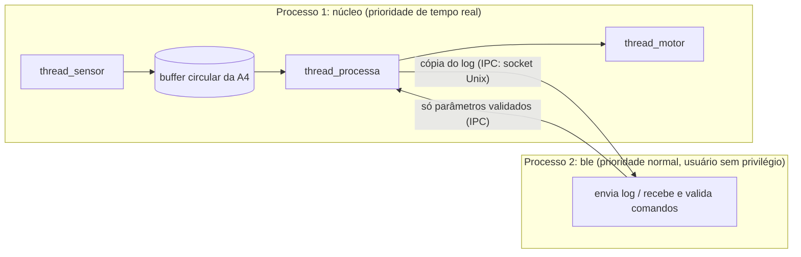
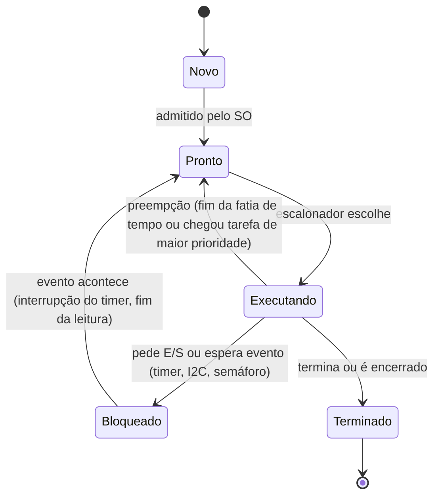
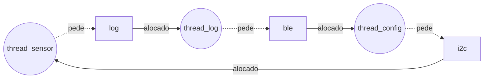

**Maria Clara Oliveira Santos** · D1 = 5 · D2 = 4 · N = 7

# Ponderada CC08: do pipeline ao deadlock (pulseira Tato)

## Parâmetros individuais

Nome completo: Maria Clara Oliveira Santos. Contei só as letras.

| Palavra | Maria | Clara | Oliveira | Santos | Total |
|---|---|---|---|---|---|
| Letras | 5 | 5 | 8 | 6 | **24** |

- **D1** = letras do primeiro nome = **5**
- **D2** = último dígito de 24 = **4**

| Parâmetro | Fórmula | Conta | Valor |
|---|---|---|---|
| IC (instruções por amostra) | 100.000 + 20.000 × D2 | 100.000 + 20.000 × 4 | **180.000** |
| m (taxa de falta na L1 da Plataforma V) | 3% + 0,5% × D1 | 3% + 0,5% × 5 | **5,5% = 0,055** |
| N (posições do buffer) | 3 + (D2 mod 5) | 3 + (4 mod 5) = 3 + 4 | **7** |

Prazo de cada amostra: **5 ms**, chegando uma amostra a cada 10 ms.

---

# Parte A: o problema técnico

## A1. Arquitetura e memória: qual processador vai na pulseira?

### Plataforma H (microcontrolador Harvard, 48 MHz, CPI 1,5)

A SRAM interna responde em 1 ciclo e não há cache. Então o CPI de 1,5 já é o CPI real.

```
ciclos por amostra = IC × CPI       = 180.000 × 1,5      = 270.000 ciclos
tempo por amostra  = ciclos / clock = 270.000 / 48×10⁶ Hz = 0,005625 s = 5,625 ms
```

**5,625 ms > 5 ms: a Plataforma H sozinha NÃO atende.** Ela estoura o prazo em 0,625 ms (12,5% acima).
Para caber em 5 ms, o IC teria que ser no máximo 5 ms × 48×10⁶ / 1,5 = 160.000 instruções. O meu IC é 180.000.

### Plataforma V (SoC Von Neumann, 1,2 GHz, cache L1, Linux)

**Tempo médio de acesso à memória (AMAT):**

```
AMAT = tempo de acerto + m × penalidade de falta
     = 1 + 0,055 × 120
     = 1 + 6,6
     = 7,6 ciclos por acesso
```

**CPI efetivo**, com 1,3 acessos por instrução:

```
CPI efetivo = 1,0 + (acessos por instrução × m × penalidade)
            = 1,0 + (1,3 × 0,055 × 120)
            = 1,0 + 8,58
            = 9,58
```

**Tempo por amostra (caso médio):**

```
ciclos = 180.000 × 9,58          = 1.724.400 ciclos
tempo  = 1.724.400 / 1,2×10⁹ Hz  = 0,001437 s ≈ 1,437 ms
```

**Pior caso**, somando o atraso do Linux:

```
pior caso = 1,437 ms + 3 ms = 4,437 ms
```

**4,437 ms ≤ 5 ms: a Plataforma V atende, mas com folga de só 0,563 ms (11%).**

Dois pontos me incomodam nesse resultado:

1. **Quase todo o tempo vai para a cache.** O processador faria a amostra com CPI 1,0, mas as faltas somam 8,58 ciclos por instrução. São 8,58 / 9,58 = **90% do tempo parado esperando a DRAM**.
2. **A folga depende de m.** Se a taxa de falta subir de 5,5% para cerca de 7,9% (por exemplo, a pilha BLE e o Linux disputando a mesma L1), o pior caso chega a 5 ms:
   `1 + 1,3 × 0,079 × 120 = 13,32` → `180.000 × 13,32 / 1,2×10⁹ = 2,0 ms` → `2,0 + 3 = 5,0 ms`.
   Além disso, o "até 3 ms" do Linux é uma estimativa. Um Linux comum, sem patch de tempo real, não garante esse limite.

### Plataforma H com acelerador DSP (Lei de Amdahl)

O filtro é a fração f = 0,6 do tempo e fica k = 5 vezes mais rápido.

```
speedup global = 1 / ((1 − f) + f / k)
               = 1 / (0,4 + 0,6 / 5)
               = 1 / (0,4 + 0,12)
               = 1 / 0,52
               ≈ 1,923

novo tempo = 5,625 ms / 1,923 = 5,625 × 0,52 = 2,925 ms
```

Conferindo por partes: os 40% que não mudam levam 0,4 × 5,625 = 2,25 ms, e o filtro leva 0,6 × 5,625 / 5 = 0,675 ms. Somando, 2,25 + 0,675 = **2,925 ms**.

**2,925 ms ≤ 5 ms: agora atende, com folga de 2,075 ms (41,5%).** E esse tempo é sempre o mesmo, porque não há cache nem sistema operacional que possam interromper a tarefa.

Repare no limite da Lei de Amdahl: mesmo com um DSP infinitamente rápido, o speedup não passaria de 1 / 0,4 = 2,5×, porque os 40% que não são filtro continuam iguais.

### Resumo

| Plataforma | Tempo médio | Pior caso | Atende 5 ms? | Folga no pior caso |
|---|---|---|---|---|
| H | 5,625 ms | 5,625 ms | **Não** | −0,625 ms |
| V | 1,437 ms | 4,437 ms | Sim | 0,563 ms (11%) |
| H + DSP | 2,925 ms | 2,925 ms | Sim | 2,075 ms (41,5%) |

### Por que a V precisa de cache e a H funciona sem?

Na arquitetura Von Neumann, instruções e dados passam pelo mesmo barramento e pela mesma memória. Com 1,3 acessos por instrução e uma DRAM externa de 120 ciclos, o processador de 1,2 GHz passaria quase todo o tempo esperando o barramento: esse é o gargalo de Von Neumann. A cache guarda perto do núcleo o que está em uso, e assim a maior parte dos acessos sai em 1 ciclo.
Na H, a arquitetura Harvard busca a instrução e o dado por caminhos separados, ao mesmo tempo. A SRAM interna responde em 1 ciclo a 48 MHz, então a memória acompanha o processador e não há gargalo para a cache esconder.

### Evidência da minha máquina


O processador é um Intel Core i5-1345U, com 2 núcleos de desempenho (P) e 8 de eficiência (E). O Windows mostra as caches separadas por tipo de núcleo:

| Nível | Núcleos P (2) | Núcleos E (8) | Tipo |
|---|---|---|---|
| L1 de dados | 96 KB (2 × 48 KB) | 256 KB (8 × 32 KB) | Só dados |
| L1 de instruções | 64 KB (2 × 32 KB) | 512 KB (8 × 64 KB) | Só instruções |
| L2 | 2.560 KB | 4.096 KB | Unificada |
| L3 | 12.288 KB (a mesma L3, mostrada duas vezes) | | Unificada |

**A L1 é dividida em instruções e dados.** Nesse nível, o núcleo busca a próxima instrução e lê um dado no mesmo ciclo, por caminhos separados, como numa Harvard.
**Mesmo assim, o computador é Von Neumann.** A L2, a L3 e a RAM são unificadas: programa e dados ficam no mesmo espaço de endereçamento e chegam pelo mesmo barramento de memória. Um programa pode inclusive gerar código e depois executá-lo. A divisão só existe dentro do núcleo. O nome técnico disso é **"Harvard modificada"**: é uma máquina Von Neumann que usa uma L1 dividida para aliviar o gargalo de Von Neumann.

---

## A2. Pipeline: o loop do filtro

```
1  lw   x5, 0(x10)     # lê a amostra nova
2  add  x6, x6, x5     # soma += nova
3  lw   x7, 0(x11)     # lê a amostra mais antiga
4  sub  x6, x6, x7     # soma -= antiga
5  sw   x6, 0(x12)     # grava a soma
6  addi x10, x10, 4    # avança o ponteiro da nova
7  addi x11, x11, 4    # avança o ponteiro da antiga
```

### Dependências de dados (RAW)

| Depende | De | Registrador | Tipo |
|---|---|---|---|
| 2 (add) | 1 (lw) | x5 | load-use |
| 4 (sub) | 2 (add) | x6 | ALU → ALU |
| 4 (sub) | 3 (lw) | x7 | load-use |
| 5 (sw) | 4 (sub) | x6 | ALU → store |

A 6 e a 7 escrevem x10 e x11, que a 1 e a 3 leem. Isso é WAR (anti-dependência), não RAW. Num pipeline em ordem, a 1 lê x10 no seu ID, muito antes de a 6 escrever, então não há conflito.

### Sem forwarding

Regra: o registrador é escrito na 1ª metade do ciclo e lido na 2ª. Por isso a instrução dependente pode fazer o ID no **mesmo ciclo** do WB da instrução que produz o valor. Uma dependência entre instruções vizinhas custa 2 bolhas.
Legenda: **•** = instrução parada (bolha).

| Instr. | 1 | 2 | 3 | 4 | 5 | 6 | 7 | 8 | 9 | 10 | 11 | 12 | 13 | 14 | 15 | 16 | 17 |
|---|---|---|---|---|---|---|---|---|---|---|---|---|---|---|---|---|---|
| 1 lw x5 | IF | ID | EX | MEM | WB | | | | | | | | | | | | |
| 2 add x6 | | IF | • | • | ID | EX | MEM | WB | | | | | | | | | |
| 3 lw x7 | | | IF | • | • | ID | EX | MEM | WB | | | | | | | | |
| 4 sub x6 | | | | | | IF | • | • | ID | EX | MEM | WB | | | | | |
| 5 sw x6 | | | | | | | IF | • | • | • | • | ID | EX | MEM | WB | | |
| 6 addi x10 | | | | | | | | | | IF | • | • | ID | EX | MEM | WB | |
| 7 addi x11 | | | | | | | | | | | | | IF | ID | EX | MEM | WB |

- A 2 lê x5 no ciclo 5, o mesmo ciclo do WB da 1: 2 bolhas.
- A 4 lê x7 no ciclo 9, o mesmo ciclo do WB da 3: 2 bolhas. O x6 da 2 já está pronto desde o ciclo 8.
- A 5 lê x6 no ciclo 12, o mesmo ciclo do WB da 4: 2 bolhas.

**Total: 17 ciclos.** O ideal seria 5 + (7 − 1) = 11 ciclos, então são 6 bolhas.

### Com forwarding

O resultado da ULA passa direto de EX/MEM ou MEM/WB para a entrada da ULA. Dependências ULA → ULA deixam de custar bolha. O load-use ainda custa 1.

| Instr. | 1 | 2 | 3 | 4 | 5 | 6 | 7 | 8 | 9 | 10 | 11 | 12 | 13 |
|---|---|---|---|---|---|---|---|---|---|---|---|---|---|
| 1 lw x5 | IF | ID | EX | MEM | WB | | | | | | | | |
| 2 add x6 | | IF | • | ID | EX | MEM | WB | | | | | | |
| 3 lw x7 | | | IF | • | ID | EX | MEM | WB | | | | | |
| 4 sub x6 | | | | | IF | • | ID | EX | MEM | WB | | | |
| 5 sw x6 | | | | | | IF | • | ID | EX | MEM | WB | | |
| 6 addi x10 | | | | | | | | IF | ID | EX | MEM | WB | |
| 7 addi x11 | | | | | | | | | IF | ID | EX | MEM | WB |

**Total: 13 ciclos** (11 + 2 bolhas).

**O que ainda causa bolha são os dois load-use: 1 → 2 (x5) e 3 → 4 (x7).** O `lw` só tem o dado no fim do estágio MEM, e a instrução logo atrás precisa dele no começo do seu EX, que acontece nesse mesmo ciclo. O forwarding leva um valor de um estágio para outro, mas não volta no tempo. É preciso esperar 1 ciclo para o dado sair de MEM/WB e ser repassado ao EX.
A dependência 4 → 5 não custa nada: o `sub` tem o x6 no fim do EX, e o forwarding o entrega ao EX do `sw` no ciclo seguinte.

### Reordenando para eliminar as bolhas

Basta trocar a 2 e a 3 de lugar, e assim os dois `lw` ficam juntos no começo:

```
1  lw   x5, 0(x10)     # lê a amostra nova
3  lw   x7, 0(x11)     # lê a amostra mais antiga
2  add  x6, x6, x5     # soma += nova      (x5 está 2 instruções atrás)
4  sub  x6, x6, x7     # soma -= antiga    (x7 está 2 instruções atrás)
5  sw   x6, 0(x12)     # grava a soma
6  addi x10, x10, 4
7  addi x11, x11, 4
```

O resultado não muda. As instruções 2 e 3 não usam nenhum registrador em comum. A 6 e a 7 continuam depois dos `lw` que leem x10 e x11. O `sw` continua depois do `sub`.

| Instr. | 1 | 2 | 3 | 4 | 5 | 6 | 7 | 8 | 9 | 10 | 11 |
|---|---|---|---|---|---|---|---|---|---|---|---|
| lw x5 | IF | ID | EX | MEM | WB | | | | | | |
| lw x7 | | IF | ID | EX | MEM | WB | | | | | |
| add x6 | | | IF | ID | EX | MEM | WB | | | | |
| sub x6 | | | | IF | ID | EX | MEM | WB | | | |
| sw x6 | | | | | IF | ID | EX | MEM | WB | | |
| addi x10 | | | | | | IF | ID | EX | MEM | WB | |
| addi x11 | | | | | | | IF | ID | EX | MEM | WB |

- O `add` faz o EX no ciclo 5, e o x5 sai do `lw` no fim do ciclo 4 (MEM/WB → EX).
- O `sub` faz o EX no ciclo 6. O x7 sai do `lw x7` no fim do ciclo 5 (MEM/WB → EX), e o x6 vem do `add` (EX/MEM → EX).
- O `sw` recebe o x6 do `sub` por EX/MEM → EX.

**Total: 11 ciclos, sem nenhuma bolha.** Sem forwarding eram 17 ciclos, com forwarding 13 e com forwarding e reordenação 11: 35% menos ciclos que o original.

---

## A3. Processos e threads: como organizar o software

### Organização proposta



- **Threads do mesmo processo: sensor, processamento e motor.**
  - *Compartilhamento de memória:* as três trabalham sobre as mesmas amostras. Como threads, elas dividem o buffer da A4 direto na memória, sem copiar nada e sem chamada de sistema a cada amostra.
  - *Custo:* são criadas uma vez, no boot. A troca entre threads do mesmo processo não troca o espaço de endereçamento, então é mais barata do que entre processos: não precisa esvaziar a TLB nem trocar a tabela de páginas. Esse custo se repete a cada 10 ms, dentro do caminho que tem prazo de 5 ms.
  - *Isolamento:* separar essas três não traria ganho. Se qualquer uma delas cair, a pulseira para de avisar de obstáculos de qualquer jeito, então elas falham juntas de todo modo.
- **Processo separado: BLE.**
  - *Compartilhamento:* o BLE só precisa de uma cópia do log e de mandar comandos de configuração de vez em quando. Ele não precisa ver a memória das amostras.
  - *Custo:* a comunicação por IPC é mais cara, mas acontece fora do caminho crítico. O log pode ir em lotes, por exemplo a cada 100 ms. Esse custo não entra nos 5 ms.
  - *Isolamento:* é a única tarefa que conversa com o mundo de fora e a que tem o código mais complexo (pilha Bluetooth, parser de comandos). Se ela travar ou cair, o sistema reinicia só esse processo e a vibração continua.

### O módulo BLE recebe dados de fora: thread ou processo?

- **Como thread** do processo principal, ele divide o mesmo espaço de endereçamento. Um estouro de buffer explorado no parser BLE vira código do atacante rodando com acesso a **toda** a memória: ele pode zerar o limiar de distância, desligar a vibração sem nenhum aviso, adulterar as amostras ou simplesmente derrubar o processo, e aí sensor e motor morrem junto. Para quem usa a pulseira, isso é andar sem aviso de obstáculo.
- **Como processo separado**, a MMU isola a memória. O atacante fica preso no processo BLE, com as permissões dele: um usuário sem privilégio, que pode ainda ser restringido com seccomp. Para afetar o motor, ele teria que passar pela interface de IPC, que só aceita mensagens validadas (parâmetros dentro de faixas permitidas), ou achar uma segunda falha no kernel. Se o processo BLE cair, o kernel encerra só ele e o núcleo continua vibrando.

### Diagrama de estados de um processo



**A thread do sensor passa quase todo o tempo em Bloqueado.** Ela acorda a cada 10 ms com o timer, dispara a leitura no I2C, volta a bloquear enquanto o barramento transfere os bytes (a interrupção avisa quando terminou), põe a amostra no buffer e dorme até o próximo período. O trabalho de CPU dela é mínimo: copiar alguns bytes e fazer o `signal(cheio)`. Isso leva microssegundos de um período de 10 ms, menos de 1% do tempo em Executando. O resto do tempo ela espera o relógio e o hardware, que é o papel de uma tarefa de E/S.

---

## A4. Código com semáforos: o buffer entre o sensor e o motor

O código está em [`codigo/`](codigo/) (Python 3, `threading`, sem dependências externas):

| Arquivo | O que faz |
|---|---|
| `versao1.py` | Contador compartilhado `ocupadas` + espera ocupada, com `time.sleep(0)` entre ler e escrever o contador |
| `versao2.py` | Semáforos `vazio` (N), `cheio` (0) e `mutex` (1) |
| `versao3.py` | Igual à 2, mas o produtor faz `wait(mutex)` antes de `wait(vazio)` |
| `comum.py` | Parâmetros (N = 7, 20.000 amostras, 1 s de travamento), análise e tabelas |

Cada script roda as **3 execuções** com **20.000 amostras** e **N = 7** com um único comando (`python versao1.py`).
Como contei:
- **consumidas** = leituras que o motor fez do buffer;
- **perdidas** = amostras de 0 a 19.999 que nunca chegaram ao motor;
- **duplicadas** = leituras a mais, de uma amostra que já tinha sido lida.

### Tabela de resultados

| Versão | Execução | Consumidas | Perdidas | Duplicadas | Travou? |
|---|---|---|---|---|---|
| 1 (sem sincronização) | 1 | 20.000 | 2.866 | 2.866 | Não |
| 1 (sem sincronização) | 2 | 18.550 | 3.207 | 1.757 | **Sim** |
| 1 (sem sincronização) | 3 | 19.681 | 1.367 | 1.048 | **Sim** |
| 2 (semáforos) | 1 | 20.000 | 0 | 0 | Não |
| 2 (semáforos) | 2 | 20.000 | 0 | 0 | Não |
| 2 (semáforos) | 3 | 20.000 | 0 | 0 | Não |
| 3 (ordem trocada) | 1 | 0 | 20.000 | 0 | **Sim** |
| 3 (ordem trocada) | 2 | 0 | 20.000 | 0 | **Sim** |
| 3 (ordem trocada) | 3 | 0 | 20.000 | 0 | **Sim** |

### Prints

**Versão 1:**


**Versão 2:**


**Versão 3:**


### Região crítica da versão 1 e por que ela perde e duplica

A região crítica é a **leitura-modificação-escrita do contador `ocupadas`**:

```python
lido = estado.ocupadas      # lê
time.sleep(0)               # a thread perde a CPU aqui
estado.ocupadas = lido + 1  # escreve (no consumidor: lido - 1)
```

Junto com ela vai a escrita ou a leitura da posição do buffer, que só é segura se o contador estiver certo.
Se as duas threads entram nessa região ao mesmo tempo, uma atualização apaga a outra (*lost update*).
Exemplo com `ocupadas = 3`: o produtor lê 3 e perde a CPU; o consumidor lê 3 e escreve 2; o produtor volta e escreve 4. Entrou uma amostra e saiu uma, então o certo seria 3, mas o contador ficou em 4.

- **Contador acima do real → duplicadas.** O consumidor acha que há mais amostras do que há e lê uma posição que já consumiu.
- **Contador abaixo do real → perdidas.** Quando é o consumidor que escreve por último, o contador fica em 2 com 3 amostras no buffer. O produtor acha que há uma posição livre a mais e sobrescreve uma amostra que o motor ainda não leu.
- **Travamento.** Nas execuções 2 e 3, o contador terminou em 0 com amostras "esquecidas". O produtor já tinha acabado, e o consumidor ficou esperando amostras que, para o contador, não existiam. Depois de 1 s sem receber nada, a execução foi registrada como travada. Na execução 1 o erro foi para o outro lado: o contador terminou em 7, o motor fez as 20.000 leituras, mas 2.866 delas eram repetidas.

Os números mudam a cada execução porque dependem de onde o escalonador interrompe cada thread. Esse é o sinal de uma condição de corrida.

### O que cada semáforo garante na versão 2

- **`vazio` (começa em N = 7)** conta as posições livres. O produtor faz `wait(vazio)` antes de escrever. Com o buffer cheio, ele dorme em vez de sobrescrever. Isso garante que **nenhuma amostra é perdida**.
- **`cheio` (começa em 0)** conta as posições ocupadas. O consumidor faz `wait(cheio)` antes de ler. Com o buffer vazio, ele dorme em vez de reler. Isso garante que **nenhuma amostra é duplicada** e que nenhuma posição vazia é lida.
- **`mutex` (começa em 1)** garante exclusão mútua: só uma thread por vez mexe no buffer e nos índices. Por isso o mesmo `time.sleep(0)` da versão 1, que continua dentro da região crítica da versão 2, não causa mais erro.

O contador problemático da versão 1 foi trocado pelos contadores dos semáforos, e `wait`/`signal` são **atômicos**: o sistema garante que ninguém interrompe uma atualização no meio. As threads também deixam de gastar CPU girando, porque dormem até serem acordadas. Resultado: 20.000 consumidas, 0 perdidas e 0 duplicadas nas três execuções.

### O que aconteceu na versão 3 e por quê

As três execuções **travaram sem o motor receber nenhuma amostra**. O print mostra onde cada thread parou: `produtor: SEGURA mutex, esperando vazio | consumidor: passou de cheio, esperando mutex`.

1. O produtor começa primeiro e escreve 7 amostras. Agora `vazio` = 0 e `cheio` = 7.
2. Na 8ª amostra, ele faz `wait(mutex)`, consegue, e depois `wait(vazio)`. O buffer está cheio, então ele **dorme segurando o mutex**.
3. O consumidor faz `wait(cheio)`, que passa porque há 7 amostras, e depois `wait(mutex)`. O mutex está com o produtor, então ele também dorme.
4. Só o consumidor poderia fazer `signal(vazio)`, e ele só faria isso depois de pegar o mutex. Só o produtor poderia soltar o mutex, e ele só faria isso depois de passar por `vazio`. **Deadlock**: cada uma segura o que a outra precisa.

As quatro condições aparecem: exclusão mútua (mutex), posse e espera (o produtor segura o mutex e espera `vazio`), não preempção (ninguém tira o mutex do produtor) e espera circular (produtor → `vazio` → consumidor → `mutex` → produtor).

Aqui o deadlock aconteceu logo no início, porque o produtor encheu o buffer antes de o consumidor chegar ao mutex. Na pulseira real, ele aconteceria na primeira vez em que o motor ficasse 7 amostras para trás (7 × 10 ms = 70 ms). A regra é: **nunca dormir esperando um recurso (`vazio`) segurando o mutex**. Os semáforos de contagem vêm sempre antes do mutex.

---

## A5. Deadlock: a pulseira congelou

### Sequência que leva ao deadlock

| Passo | Thread | Operação | Resultado |
|---|---|---|---|
| 1 | thread_sensor | `P(i2c)` | consegue: segura **i2c** |
| 2 | thread_log | `P(log)` | consegue: segura **log** |
| 3 | thread_config | `P(ble)` | consegue: segura **ble** |
| 4 | thread_sensor | `le_sensor()`, depois `P(log)` | **bloqueia**: log está com a thread_log |
| 5 | thread_log | `le_log()`, depois `P(ble)` | **bloqueia**: ble está com a thread_config |
| 6 | thread_config | `recebe_comando()`, depois `P(i2c)` | **bloqueia**: i2c está com a thread_sensor |

Basta o escalonador trocar de thread logo depois do primeiro `P` de cada uma. As três ficam bloqueadas para sempre, e nenhuma vai chegar ao `V` que liberaria a outra. A thread_sensor está parada, então a pulseira para de ler o sensor: congela até ser desligada.

### Grafo de alocação de recursos nesse instante

Seta recurso → thread = o recurso está alocado à thread. Seta thread → recurso = a thread está pedindo o recurso.



O ciclo é thread_sensor → log → thread_log → ble → thread_config → i2c → thread_sensor. Como cada recurso tem uma única instância (semáforo binário), um ciclo no grafo significa deadlock.

### As quatro condições no código

| Condição | Onde aparece |
|---|---|
| **Exclusão mútua** | Os três semáforos começam em 1: só uma thread por vez usa o barramento I2C, o arquivo de log ou o rádio. Isso é necessário de verdade, porque duas threads falando no I2C ao mesmo tempo corrompem a transação. |
| **Posse e espera** | Cada thread faz o segundo `P` sem soltar o primeiro: a sensor segura i2c e pede log, a log segura log e pede ble, a config segura ble e pede i2c. |
| **Não preempção** | Um semáforo não pode ser tomado à força. Só quem fez o `P` faz o `V`, e o sistema não tem como tirar o i2c da thread_sensor para dar à thread_config. |
| **Espera circular** | As três pegam os recursos em ordens que fecham um ciclo: i2c→log, log→ble, ble→i2c. Não existe uma ordem global que todas respeitem. |

### Correção 1 (prevenção): acabar com a posse e espera

Cada thread copia o que precisa e solta o primeiro recurso antes de pedir o segundo. Nenhuma thread segura um recurso enquanto espera outro:

```
thread_sensor:          thread_log:              thread_config:
  P(i2c)                  P(log)                   P(ble)
  a = le_sensor()         buf = le_log()           cmd = recebe_comando()
  V(i2c)                  V(log)                   V(ble)
  P(log)                  P(ble)                   P(i2c)
  registra(a)             envia(buf)               ajusta_sensor(cmd)
  V(log)                  V(ble)                   V(i2c)
```

Escolhi essa em vez de só impor uma ordem global (i2c < log < ble) por causa da thread_config. Com ordem global, ela teria que fazer `P(i2c)` antes de `P(ble)`, e ficaria **segurando o barramento do sensor enquanto espera um comando chegar pelo rádio**. Isso pode levar centenas de milissegundos, e a leitura do sensor estouraria os 5 ms. Soltando o recurso antes de pedir o próximo, cada semáforo fica preso só pelo tempo de uma operação curta.

**Para quem usa:** nada muda na experiência, e a pulseira deixa de congelar. A única diferença é que um comando de configuração vindo do app passa a valer alguns milissegundos depois, o que ninguém percebe.

### Correção 2 (detecção e recuperação): watchdog com timeout

O código continua como está, e o sistema passa a detectar o travamento e se recuperar:

1. Todo `P` vira `sem_timedwait` com limite de, por exemplo, 20 ms. Se estourar, a thread solta o que segura, registra o evento e tenta de novo depois de um intervalo aleatório. Isso quebra a não preempção por desistência.
2. Um **watchdog de hardware** precisa ser "alimentado" pelo laço principal a cada 10 ms. Se ficar mais de 50 ms sem sinal, o chip reinicia a pulseira sozinho.

**Para quem usa:** o deadlock continua podendo acontecer (cerca de 1 vez a cada 10.000 horas), mas deixa de ser permanente. Pelo timeout, a pessoa nem percebe: perde no máximo umas poucas amostras. Se o watchdog precisar reiniciar a pulseira, a pessoa fica cerca de 4 s sem vibração, avisada por um pulso longo. É muito melhor do que congelar até alguém perceber e desligar, mas são 4 s andando às cegas. Por isso trato essa correção como rede de segurança, não como solução definitiva.

---

# Parte B: a decisão do CTO

## Memorando ao conselho da Tato: Dilema 2, qual processador vai para a produção

**Decisão: a pulseira vai para a produção com a Plataforma H (microcontrolador Harvard) com o acelerador DSP, a R$ 37 por unidade.**

**Por que.** O requisito que não se negocia é processar cada amostra em até 5 ms. Medi as três opções com os parâmetros do nosso software:

- A H sozinha leva **5,625 ms** e não serve.
- Com o DSP, cai para **2,925 ms**, com 41,5% de folga. Esse tempo é sempre o mesmo, porque não há sistema operacional nem cache para atrasar a tarefa.
- A V passa no papel, mas com folga mínima: **1,437 ms** em média e **4,437 ms** no pior caso, contando 3 ms de atraso do Linux. Sobram 0,56 ms. Basta a taxa de falta na cache subir de 5,5% para 7,9%, ou o Linux atrasar um pouco mais que os 3 ms estimados, e a pulseira estoura o prazo.

Esse foi o número que decidiu: 4,437 ms. Num produto em que um atraso é um poste não avisado, não aceito um pior caso que depende de o Linux se comportar.

**Do que estou abrindo mão.** Da atualização pela internet (OTA). Toda correção de firmware, como a do deadlock da A5, vai exigir que a pulseira vá à assistência técnica e seja atualizada por cabo. Quem paga esse custo:

- **o usuário**, que fica dias sem a pulseira ou depende de alguém para levá-la;
- **a empresa**, que paga frete e atendimento.

Também abro mão do ecossistema Linux (bibliotecas prontas, desenvolvimento mais rápido de novas funções). Em troca, economizamos R$ 33 por unidade: R$ 66 mil nas 2.000 pulseiras do edital, que viram cerca de 1.780 pulseiras a mais com o mesmo dinheiro.

**Impacto em quem usa.**
- O aviso de obstáculo chega sempre no mesmo tempo, sem picos.
- Um microcontrolador de 48 MHz gasta bem menos energia do que um SoC de 1,2 GHz rodando Linux, então a bateria dura mais.
- O lado ruim são as atualizações, que ficam mais raras e mais trabalhosas.

**Risco de segurança.** A superfície de ataque da H é pequena: sem Linux, sem shell e sem serviços de rede, só a interface BLE. O risco que fica é uma falha nessa interface que a gente não consiga corrigir remotamente. Para reduzir esse risco:
- a interface BLE vai aceitar só mensagens de log e parâmetros de configuração dentro de faixas válidas, com firmware assinado no bootloader;
- vamos manter o watchdog;
- o código BLE vai passar por revisão de segurança antes do lançamento, porque não poderemos corrigi-lo depressa depois.

**O que me faria mudar de ideia.** Se, nos 6 primeiros meses em campo, precisarmos de **mais de uma atualização de firmware por cabo por pulseira**, eu mudo. Estimamos cerca de R$ 30 por atendimento (frete + técnico). Com duas idas à assistência, o custo passa da economia de R$ 33 por unidade, e o usuário fica dias sem a pulseira em cada uma. Nesse caso, eu reabro a discussão pela Plataforma V com kernel de tempo real (PREEMPT_RT), desde que um teste de 72 h mostre o pior caso total abaixo de 4 ms.

---

# Anexo: atividade da aula S2: ARQUITETURA DE COMPUTADORES: PIPELINES E PARALELISMO

A atividade do Colab da aula 02 faz parte desta entrega: [atividade-s2/aula02_cc08_colab_atividade.ipynb](atividade-s2/aula02_cc08_colab_atividade.ipynb). O notebook está salvo com todas as saídas e a célula de respostas preenchida.

Ela mede na prática os efeitos de pipeline usados na Parte A:

- **Previsão de desvio (Parte 1):** cada erro de previsão custou ≈ 6,5 ns (≈ 15 ciclos), porque o pipeline é esvaziado e recarregado. É o mesmo mecanismo das bolhas da A2, só que maior.
- **Latência e vazão (Parte 2):** com uma única cadeia de somas dependentes, cada soma espera a anterior, como o `add`/`sub` em `x6` da A2. Com 6 cadeias independentes, o núcleo chegou a 2 somas por ciclo.
- **SMT (Parte 3):** com 2 threads, os dois modos quase dobraram. Na máquina virtual do Colab, as duas vCPUs estavam em núcleos físicos diferentes.
