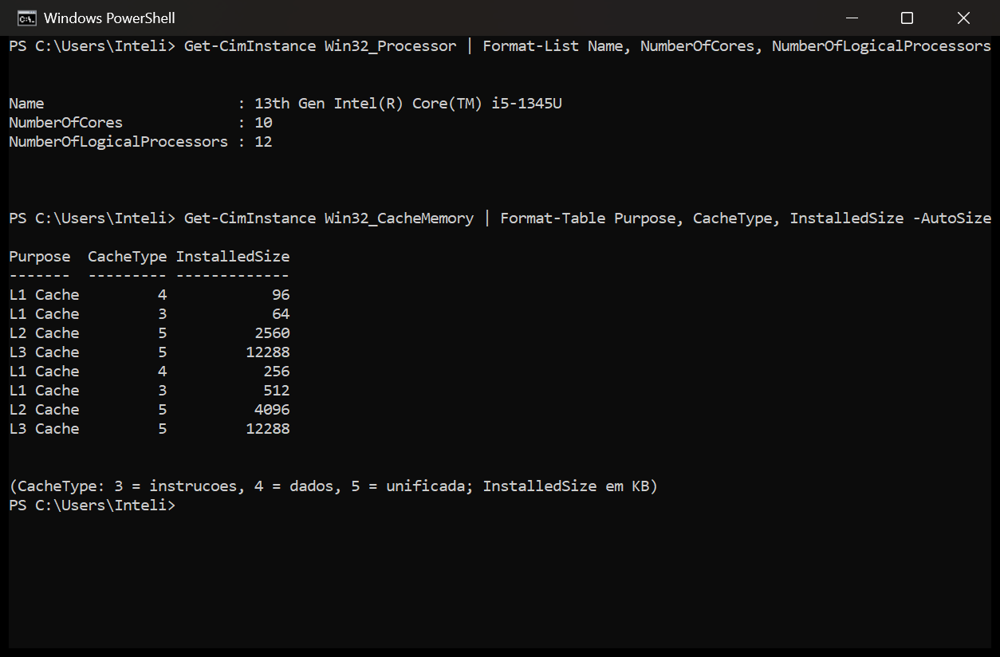
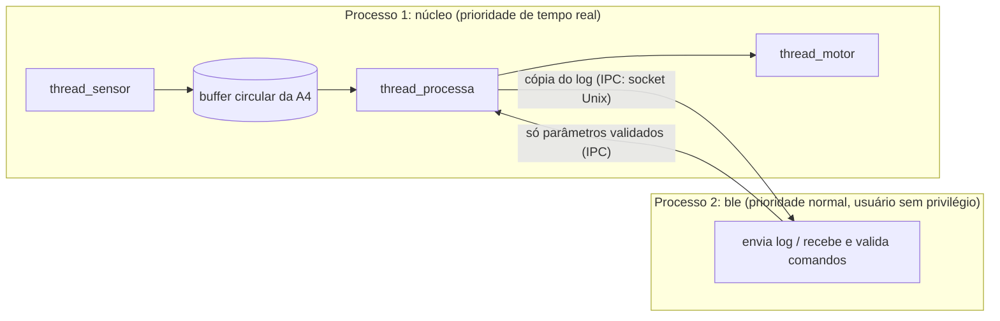
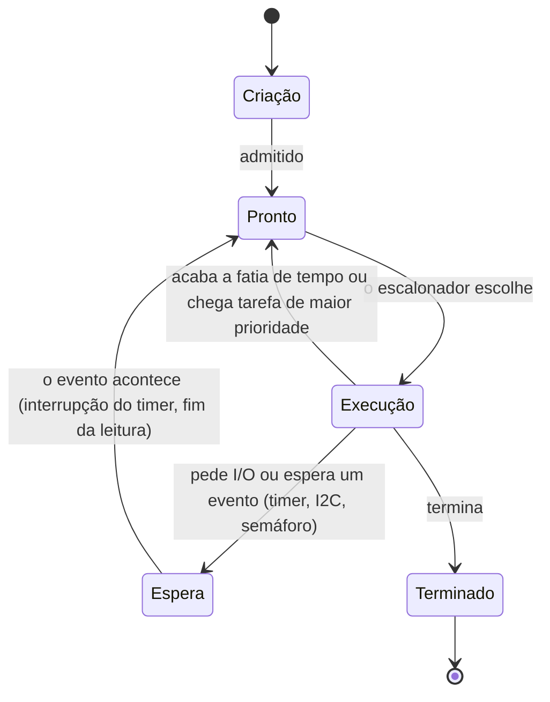
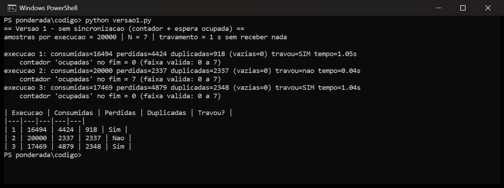
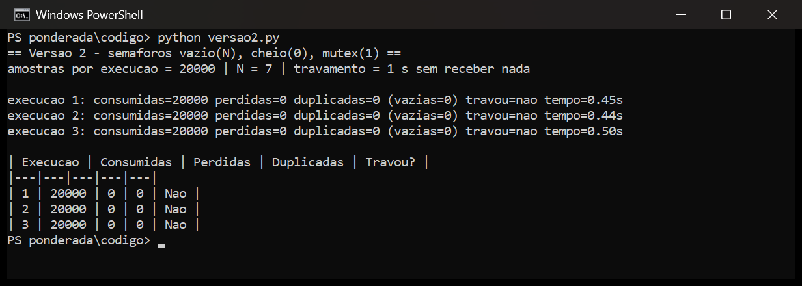
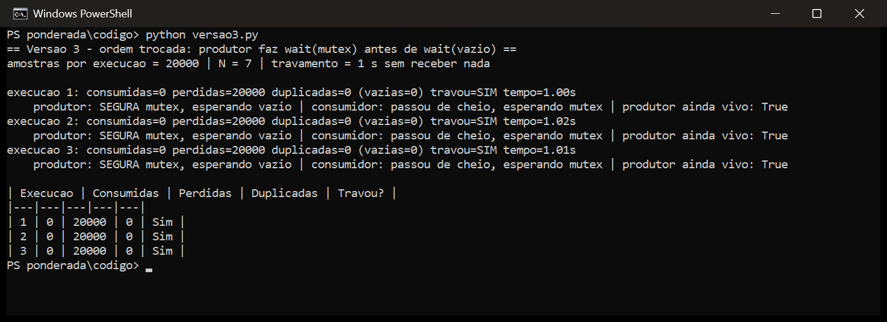
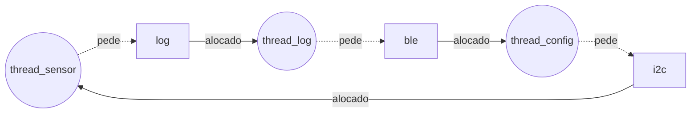

**Maria Clara Oliveira Santos** · D1 = 5 · D2 = 4 · N = 7

# Ponderada CC08: do pipeline ao deadlock (pulseira Tato)

A pulseira Tato lê um sensor de distância a cada 10 ms e precisa processar cada amostra em até 5 ms. A Parte A analisa o produto em cinco frentes (processador e memória, pipeline do filtro, organização do software, buffer com semáforos e um deadlock relatado por cliente). A Parte B usa esses resultados para decidir qual processador vai para a produção.

## Parâmetros individuais

O nome completo é Maria Clara Oliveira Santos. Na contagem, entram apenas as letras.

*Tabela 1: letras do nome completo.*

| Palavra | Maria | Clara | Oliveira | Santos | Total |
|---|---|---|---|---|---|
| Letras | 5 | 5 | 8 | 6 | 24 |

O primeiro nome tem 5 letras, então D1 = 5. O total é 24, e o último dígito dá D2 = 4.

*Tabela 2: parâmetros calculados a partir de D1 e D2.*

| Parâmetro | Fórmula | Conta | Valor |
|---|---|---|---|
| IC (instruções por amostra) | 100.000 + 20.000 × D2 | 100.000 + 20.000 × 4 | 180.000 |
| m (taxa de falta na L1 da Plataforma V) | 3% + 0,5% × D1 | 3% + 0,5% × 5 | 5,5% = 0,055 |
| N (posições do buffer) | 3 + (D2 mod 5) | 3 + (4 mod 5) = 3 + 4 | 7 |

---

# Parte A: o problema técnico

## A1. Arquitetura e memória: qual processador vai na pulseira?

### Plataforma H (microcontrolador Harvard, 48 MHz, CPI 1,5)

A SRAM interna responde em 1 ciclo e não há cache, então o CPI de 1,5 já é o CPI real. Pela equação do desempenho, Tempo = IC × CPI × T_clock = IC × CPI / f:

```
ciclos por amostra = IC × CPI = 180.000 × 1,5        = 270.000 ciclos
tempo por amostra  = ciclos / f = 270.000 / 48×10⁶ Hz = 0,005625 s = 5,625 ms
```

Como 5,625 ms > 5 ms, a Plataforma H sozinha não atende. Ela passa do prazo em 0,625 ms (12,5%). Para caber em 5 ms, o IC teria que ser no máximo 5 ms × 48×10⁶ / 1,5 = 160.000 instruções.

### Plataforma V (SoC Von Neumann, 1,2 GHz, cache L1, Linux)

Tempo médio de acesso à memória (AMAT):

```
AMAT = tempo de acerto + taxa de falta × penalidade de falta
     = 1 + 0,055 × 120
     = 1 + 6,6
     = 7,6 ciclos por acesso
```

CPI efetivo, com 1,3 acessos por instrução:

```
CPI efetivo = 1,0 + (acessos por instrução × m × penalidade)
            = 1,0 + (1,3 × 0,055 × 120)
            = 1,0 + 8,58
            = 9,58
```

Tempo por amostra no caso médio:

```
ciclos = 180.000 × 9,58          = 1.724.400 ciclos
tempo  = 1.724.400 / 1,2×10⁹ Hz  = 0,001437 s ≈ 1,437 ms
```

No pior caso, soma-se o atraso do Linux:

```
pior caso = 1,437 ms + 3 ms = 4,437 ms
```

Como 4,437 ms ≤ 5 ms, a Plataforma V atende, com folga de 0,563 ms (11%).

Esse resultado tem duas fragilidades. A primeira é que as faltas na cache somam 8,58 ciclos por instrução, contra 1,0 de trabalho útil: 8,58 / 9,58 = 90% do tempo o processador fica parado esperando a DRAM. A segunda é que a folga depende de m. Se a taxa de falta subir de 5,5% para cerca de 7,9%, por exemplo com a pilha BLE e o Linux disputando a mesma L1, o pior caso chega a 5 ms:

```
CPI   = 1 + 1,3 × 0,079 × 120 = 13,32
tempo = 180.000 × 13,32 / 1,2×10⁹ = 2,0 ms
pior caso = 2,0 + 3 = 5,0 ms
```

O próprio limite de 3 ms do Linux é uma estimativa, porque um kernel comum, sem patch de tempo real, não garante esse valor.

### Plataforma H com acelerador DSP (Lei de Amdahl)

O filtro ocupa a fração F = 0,6 do tempo e fica S = 5 vezes mais rápido.

```
Speedup = 1 / ((1 − F) + F / S)
        = 1 / (0,4 + 0,6 / 5)
        = 1 / (0,4 + 0,12)
        = 1 / 0,52
        ≈ 1,923

novo tempo = 5,625 ms / 1,923 = 5,625 × 0,52 = 2,925 ms
```

Conferindo por partes, os 40% que não mudam levam 0,4 × 5,625 = 2,25 ms, e o filtro passa a levar 0,6 × 5,625 / 5 = 0,675 ms, o que soma 2,925 ms.

Com 2,925 ms ≤ 5 ms, a H com DSP atende, com folga de 2,075 ms (41,5%). Esse tempo não varia, já que não existe cache nem sistema operacional para interromper a tarefa. Mesmo com um DSP infinitamente rápido, o speedup ficaria limitado a 1 / (1 − F) = 1 / 0,4 = 2,5, porque os 40% que não são filtro continuam iguais.

*Tabela 3: resumo das três opções.*

| Plataforma | Tempo médio | Pior caso | Atende 5 ms? | Folga no pior caso |
|---|---|---|---|---|
| H | 5,625 ms | 5,625 ms | Não | −0,625 ms |
| V | 1,437 ms | 4,437 ms | Sim | 0,563 ms (11%) |
| H + DSP | 2,925 ms | 2,925 ms | Sim | 2,075 ms (41,5%) |

A Tabela 3 mostra que só a H com DSP atende com folga e sem variação entre o caso médio e o pior caso.

### Por que a V precisa de cache e a H funciona sem?

Na arquitetura Von Neumann, instruções e dados disputam o mesmo barramento e a mesma memória. Na V, com 1,3 acessos por instrução e uma DRAM de 120 ciclos, o núcleo de 1,2 GHz passaria a maior parte do tempo esperando a memória, que é o gargalo de Von Neumann; a cache mantém perto do núcleo o que está em uso e atende a maioria dos acessos em 1 ciclo. A H é Harvard, busca instrução e dado por caminhos separados, e a SRAM interna responde em 1 ciclo a 48 MHz, então não há espera para a cache esconder.

### Evidência da minha máquina



*Figura 1: caches do processador do meu computador.*

O processador é um Intel Core i5-1345U, com 2 núcleos de desempenho (P) e 8 de eficiência (E). Na Figura 1, o Windows lista as caches duas vezes, uma para cada tipo de núcleo, com CacheType 3 para instruções, 4 para dados e 5 para cache unificada. A Tabela 4 resume esses valores.

*Tabela 4: caches do Intel Core i5-1345U.*

| Nível | Núcleos P (2) | Núcleos E (8) | Tipo |
|---|---|---|---|
| L1 de dados | 96 KB (2 × 48 KB) | 256 KB (8 × 32 KB) | Só dados |
| L1 de instruções | 64 KB (2 × 32 KB) | 512 KB (8 × 64 KB) | Só instruções |
| L2 | 2.560 KB | 4.096 KB | Unificada |
| L3 | 12.288 KB (a mesma L3, listada duas vezes) | | Unificada |

A L1 é dividida em instruções e dados. Nesse nível, o núcleo busca a próxima instrução e lê um dado no mesmo ciclo, por caminhos separados, como numa máquina Harvard. O computador, porém, continua sendo Von Neumann: a L2, a L3 e a RAM são unificadas, programa e dados ficam no mesmo espaço de endereçamento e chegam pelo mesmo barramento de memória, e um programa pode até gerar código e depois executá-lo. A divisão existe só dentro do núcleo. Essa combinação é chamada de Harvard modificada, uma máquina Von Neumann que usa a L1 dividida para aliviar o gargalo de Von Neumann.

---

## A2. Pipeline: o loop do filtro

```
1  lw   x5, 0(x10)     # lê a amostra nova
2  add  x6, x6, x5     # soma += nova
3  lw   x7, 0(x11)     # lê a amostra mais antiga
4  sub  x6, x6, x7     # soma -= antiga
5  sw   x6, 0(x12)     # grava a soma
6  addi x10, x10, 4    # avança o ponteiro da nova
7  addi x11, x11, 4    # avança o ponteiro da antiga
```

### Dependências de dados (RAW)

*Tabela 5: dependências verdadeiras do trecho.*

| Instrução | Depende de | Registrador | Tipo |
|---|---|---|---|
| 2 (add) | 1 (lw) | x5 | load-use |
| 4 (sub) | 2 (add) | x6 | ULA para ULA |
| 4 (sub) | 3 (lw) | x7 | load-use |
| 5 (sw) | 4 (sub) | x6 | ULA para store |

As instruções 6 e 7 escrevem x10 e x11, que a 1 e a 3 leem. Essa relação é uma antidependência (WAR), que não passa valor adiante. Num pipeline em ordem, a 1 lê x10 no seu ID, bem antes de a 6 escrever, então não há conflito.

### Sem forwarding

O banco de registradores é escrito na primeira metade do ciclo e lido na segunda. Por isso, a instrução dependente pode fazer o ID no mesmo ciclo do WB da instrução que produz o valor, e uma dependência entre instruções vizinhas custa 2 bolhas.

*Tabela 6: pipeline sem forwarding.*

| Instr. | 1 | 2 | 3 | 4 | 5 | 6 | 7 | 8 | 9 | 10 | 11 | 12 | 13 | 14 | 15 | 16 | 17 |
|---|---|---|---|---|---|---|---|---|---|---|---|---|---|---|---|---|---|
| 1 lw x5 | IF | ID | EX | MEM | WB | | | | | | | | | | | | |
| 2 add x6 | | IF | bolha | bolha | ID | EX | MEM | WB | | | | | | | | | |
| 3 lw x7 | | | IF | bolha | bolha | ID | EX | MEM | WB | | | | | | | | |
| 4 sub x6 | | | | | | IF | bolha | bolha | ID | EX | MEM | WB | | | | | |
| 5 sw x6 | | | | | | | IF | bolha | bolha | bolha | bolha | ID | EX | MEM | WB | | |
| 6 addi x10 | | | | | | | | | | IF | bolha | bolha | ID | EX | MEM | WB | |
| 7 addi x11 | | | | | | | | | | | | | IF | ID | EX | MEM | WB |

A instrução 2 lê x5 no ciclo 5, o mesmo do WB da 1, depois de 2 bolhas. A 4 lê x7 no ciclo 9, junto com o WB da 3, também depois de 2 bolhas (o x6 da 2 já está pronto desde o ciclo 8). A 5 lê x6 no ciclo 12, no WB da 4, e paga mais 2 bolhas.

O trecho leva 17 ciclos do primeiro IF ao último WB. Sem nenhuma parada seriam 5 + (7 − 1) = 11 ciclos, então as dependências custam 6 bolhas.

### Com forwarding

Com o adiantamento (forwarding), o resultado da ULA vai direto do registrador EX/MEM ou MEM/WB para a entrada da ULA. A dependência de ULA para ULA deixa de custar bolha, e o load-use passa a custar 1.

*Tabela 7: pipeline com forwarding.*

| Instr. | 1 | 2 | 3 | 4 | 5 | 6 | 7 | 8 | 9 | 10 | 11 | 12 | 13 |
|---|---|---|---|---|---|---|---|---|---|---|---|---|---|
| 1 lw x5 | IF | ID | EX | MEM | WB | | | | | | | | |
| 2 add x6 | | IF | bolha | ID | EX | MEM | WB | | | | | | |
| 3 lw x7 | | | IF | bolha | ID | EX | MEM | WB | | | | | |
| 4 sub x6 | | | | | IF | bolha | ID | EX | MEM | WB | | | |
| 5 sw x6 | | | | | | IF | bolha | ID | EX | MEM | WB | | |
| 6 addi x10 | | | | | | | | IF | ID | EX | MEM | WB | |
| 7 addi x11 | | | | | | | | | IF | ID | EX | MEM | WB |

O total cai para 13 ciclos (11 + 2 bolhas).

As duas bolhas que sobram vêm dos load-use, de 1 para 2 (x5) e de 3 para 4 (x7). O `lw` só tem o dado no fim do estágio MEM, e a instrução seguinte precisa dele no começo do seu EX, que cai nesse mesmo ciclo. O adiantamento só repassa um valor que já foi produzido; como o dado ainda não existe, a instrução espera 1 ciclo até ele sair de MEM/WB e ser repassado ao EX. Já a dependência de 4 para 5 não custa nada, porque o `sub` tem o x6 no fim do EX e o forwarding o entrega ao EX do `sw` no ciclo seguinte.

### Reordenando para eliminar as bolhas

Trocando a 2 e a 3 de lugar, os dois `lw` ficam juntos no começo:

```
1  lw   x5, 0(x10)     # lê a amostra nova
3  lw   x7, 0(x11)     # lê a amostra mais antiga
2  add  x6, x6, x5     # soma += nova      (x5 está 2 instruções atrás)
4  sub  x6, x6, x7     # soma -= antiga    (x7 está 2 instruções atrás)
5  sw   x6, 0(x12)     # grava a soma
6  addi x10, x10, 4
7  addi x11, x11, 4
```

O resultado não muda: a 2 e a 3 não usam nenhum registrador em comum, a 6 e a 7 continuam depois dos `lw` que leem x10 e x11, e o `sw` continua depois do `sub`.

*Tabela 8: pipeline com forwarding, depois da reordenação.*

| Instr. | 1 | 2 | 3 | 4 | 5 | 6 | 7 | 8 | 9 | 10 | 11 |
|---|---|---|---|---|---|---|---|---|---|---|---|
| lw x5 | IF | ID | EX | MEM | WB | | | | | | |
| lw x7 | | IF | ID | EX | MEM | WB | | | | | |
| add x6 | | | IF | ID | EX | MEM | WB | | | | |
| sub x6 | | | | IF | ID | EX | MEM | WB | | | |
| sw x6 | | | | | IF | ID | EX | MEM | WB | | |
| addi x10 | | | | | | IF | ID | EX | MEM | WB | |
| addi x11 | | | | | | | IF | ID | EX | MEM | WB |

O `add` faz o EX no ciclo 5 e recebe o x5, que saiu do `lw` no fim do ciclo 4, de MEM/WB. O `sub` faz o EX no ciclo 6 e recebe o x7 de MEM/WB e o x6 do `add` de EX/MEM. O `sw` recebe o x6 do `sub` de EX/MEM.

O trecho passa a levar 11 ciclos, sem bolha. Foram 17 ciclos sem forwarding, 13 com forwarding e 11 com forwarding e reordenação, uma redução de 35% em relação ao original.

---

## A3. Processos e threads: como organizar o software

### Organização proposta



*Figura 2: organização do software da Plataforma V.*

Sensor, processamento e motor viram threads de um mesmo processo. As três trabalham sobre as mesmas amostras e, como threads, dividem o buffer da A4 direto na memória, sem cópia e sem chamada de sistema a cada amostra. São criadas uma vez, no boot. A troca entre threads do mesmo processo mantém o espaço de endereçamento, então não troca a tabela de páginas nem esvazia a TLB, e esse custo se repete a cada 10 ms dentro do caminho que tem prazo de 5 ms. Separar essas tarefas em processos também não traria isolamento útil: se qualquer uma delas cair, a pulseira deixa de avisar sobre obstáculos de todo modo.

O BLE vira um processo separado. Ele só precisa de uma cópia do log e de enviar comandos de configuração de vez em quando, sem acesso à memória das amostras. A comunicação por IPC é mais cara, mas acontece fora do caminho crítico; o log pode ir em lotes, por exemplo a cada 100 ms, e esse custo não entra nos 5 ms. É também a única tarefa que conversa com o mundo de fora e a de código mais complexo (pilha Bluetooth e parser de comandos). Se ela travar ou cair, o sistema reinicia só esse processo, e a vibração continua.

### O módulo BLE recebe dados de fora: thread ou processo?

Como thread do processo principal, o BLE divide o mesmo espaço de endereçamento das outras tarefas. Um estouro de buffer explorado no parser vira código do atacante rodando com acesso a toda a memória. Com isso, ele pode zerar o limiar de distância, desligar a vibração sem aviso, adulterar as amostras ou derrubar o processo, levando junto as threads do sensor e do motor. Para quem usa a pulseira, o resultado é andar sem aviso de obstáculo.

Como processo separado, a MMU isola a memória. O atacante fica preso no processo BLE, com as permissões de um usuário sem privilégio, que ainda pode ser restringido com seccomp. Para chegar ao motor, ele teria que passar pela interface de IPC, que só aceita parâmetros dentro de faixas válidas, ou explorar uma segunda falha, desta vez no kernel. Se o processo BLE cair, o kernel encerra só ele, e o núcleo continua vibrando.

### Diagrama de estados de um processo



*Figura 3: estados de um processo.*

A thread do sensor passa quase todo o tempo em Espera. Ela acorda a cada 10 ms com o timer, dispara a leitura no I2C e volta a esperar enquanto o barramento transfere os bytes, até a interrupção avisar que a leitura terminou. Depois, põe a amostra no buffer e espera o próximo período. O trabalho de CPU se resume a copiar alguns bytes e fazer o UP em `cheio`, o que leva microssegundos de um período de 10 ms, menos de 1% do tempo em Execução. É uma tarefa I/O-bound: o resto do tempo ela depende do relógio e do hardware.

---

## A4. Código com semáforos: o buffer entre o sensor e o motor

O código está em [`codigo/`](codigo/), em Python 3 com `threading` e sem dependências externas.

*Tabela 9: arquivos da A4.*

| Arquivo | O que faz |
|---|---|
| `versao1.py` | Contador compartilhado `ocupadas` e espera ocupada, com `time.sleep(0)` entre ler e escrever o contador |
| `versao2.py` | Semáforos `vazio` (N), `cheio` (0) e `mutex` (1) |
| `versao3.py` | Igual à versão 2, mas o produtor faz DOWN em `mutex` antes de DOWN em `vazio` |
| `comum.py` | Parâmetros (N = 7, 20.000 amostras, 1 s para considerar travamento), análise e tabelas |

Cada script roda as 3 execuções com 20.000 amostras e N = 7 com um único comando (`python versao1.py`). Nas contagens, consumidas são as leituras que o motor fez do buffer, perdidas são as amostras de 0 a 19.999 que nunca chegaram ao motor e duplicadas são as leituras repetidas de uma amostra já lida.

### Resultados

*Tabela 10: resultados das 9 execuções.*

| Versão | Execução | Consumidas | Perdidas | Duplicadas | Travou? |
|---|---|---|---|---|---|
| 1 (sem sincronização) | 1 | 16.494 | 4.424 | 918 | Sim |
| 1 (sem sincronização) | 2 | 20.000 | 2.337 | 2.337 | Não |
| 1 (sem sincronização) | 3 | 17.469 | 4.879 | 2.348 | Sim |
| 2 (semáforos) | 1 | 20.000 | 0 | 0 | Não |
| 2 (semáforos) | 2 | 20.000 | 0 | 0 | Não |
| 2 (semáforos) | 3 | 20.000 | 0 | 0 | Não |
| 3 (ordem trocada) | 1 | 0 | 20.000 | 0 | Sim |
| 3 (ordem trocada) | 2 | 0 | 20.000 | 0 | Sim |
| 3 (ordem trocada) | 3 | 0 | 20.000 | 0 | Sim |



*Figura 4: execução da versão 1.*



*Figura 5: execução da versão 2.*



*Figura 6: execução da versão 3.*

### Região crítica da versão 1 e por que ela perde e duplica

A região crítica é a leitura, modificação e escrita do contador `ocupadas`:

```python
lido = estado.ocupadas      # lê
time.sleep(0)               # a thread perde a CPU aqui
estado.ocupadas = lido + 1  # escreve (no consumidor: lido - 1)
```

A escrita ou leitura da posição do buffer também faz parte dela, porque só é segura se o contador estiver certo. Quando as duas threads entram nesse trecho ao mesmo tempo, uma atualização apaga a outra. Com `ocupadas = 3`, por exemplo, o produtor lê 3 e perde a CPU; o consumidor lê 3 e escreve 2; o produtor volta e escreve 4. Entrou uma amostra e saiu outra, então o valor certo seria 3, mas o contador ficou em 4.

Com o contador acima do real, o consumidor acredita que há mais amostras do que existem e lê de novo uma posição já consumida, o que gera as duplicadas. Quando é o consumidor que escreve por último, o contador fica abaixo do real (2 com 3 amostras no buffer), o produtor enxerga uma posição livre a mais e sobrescreve uma amostra que o motor ainda não leu, o que gera as perdidas.

Nas execuções 1 e 3, o contador terminou em 0 com amostras esquecidas no buffer. O produtor já tinha acabado, e o consumidor ficou esperando amostras que, para o contador, não existiam; depois de 1 s sem receber nada, a execução foi registrada como travada. Na execução 2, o erro foi para o outro lado: o contador terminou em 7, o motor fez as 20.000 leituras, e 2.337 delas eram repetidas. Os números mudam a cada execução porque dependem de onde o escalonador interrompe cada thread, o sinal típico de uma condição de corrida.

### O que cada semáforo garante na versão 2

O semáforo `vazio` começa em N = 7 e conta as posições livres. O produtor faz DOWN nele antes de escrever e, com o buffer cheio, entra em espera em vez de sobrescrever, o que garante que nenhuma amostra se perde.

O `cheio` começa em 0 e conta as posições ocupadas. O consumidor faz DOWN nele antes de ler e, com o buffer vazio, espera em vez de reler, então nenhuma amostra é duplicada e nenhuma posição vazia é lida.

O `mutex` começa em 1 e garante exclusão mútua: só uma thread por vez mexe no buffer e nos índices. Por isso, o mesmo `time.sleep(0)` da versão 1, que continua dentro da região crítica, deixa de causar erro.

DOWN e UP são indivisíveis, então nenhuma troca de contexto interrompe a atualização de um semáforo no meio, ao contrário do contador da versão 1. As threads também deixam de gastar CPU em espera ocupada, porque ficam em Espera até serem acordadas. O resultado foi de 20.000 amostras consumidas, 0 perdidas e 0 duplicadas nas três execuções.

### O que aconteceu na versão 3 e por quê

As três execuções travaram sem que o motor recebesse nenhuma amostra. A Figura 6 mostra onde cada thread parou: `produtor: SEGURA mutex, esperando vazio | consumidor: passou de cheio, esperando mutex`.

1. O produtor começa primeiro e escreve 7 amostras, deixando `vazio` = 0 e `cheio` = 7.
2. Na 8ª amostra, ele faz DOWN em `mutex`, consegue, e em seguida DOWN em `vazio`. Como o buffer está cheio, ele entra em espera segurando o mutex.
3. O consumidor faz DOWN em `cheio`, que passa porque há 7 amostras, e depois DOWN em `mutex`. O mutex está com o produtor, então o consumidor também entra em espera.
4. Só o consumidor poderia fazer UP em `vazio`, e ele só faria isso depois de pegar o mutex. Só o produtor poderia liberar o mutex, e ele só faria isso depois de passar por `vazio`. Cada thread segura o que a outra precisa, o que caracteriza um deadlock.

As quatro condições estão presentes. Há exclusão mútua no mutex e espera por recurso, já que o produtor segura o mutex enquanto espera `vazio`. Não há preempção, porque nada tira o mutex do produtor, e a espera é circular: o produtor espera `vazio`, que depende do consumidor, que espera o `mutex`, que está com o produtor.

O deadlock apareceu logo no início porque o produtor encheu o buffer antes de o consumidor chegar ao mutex. Na pulseira, ele aconteceria na primeira vez em que o motor ficasse 7 amostras para trás, ou seja, 70 ms de atraso. A regra que a versão 2 segue é nunca esperar por um recurso (`vazio`) segurando o mutex: o DOWN nos semáforos contadores vem sempre antes do DOWN no mutex.

---

## A5. Deadlock: a pulseira congelou

### Sequência que leva ao deadlock

*Tabela 11: uma ordem de execução que leva ao deadlock.*

| Passo | Thread | Operação | Resultado |
|---|---|---|---|
| 1 | thread_sensor | `P(i2c)` | consegue e fica com i2c |
| 2 | thread_log | `P(log)` | consegue e fica com log |
| 3 | thread_config | `P(ble)` | consegue e fica com ble |
| 4 | thread_sensor | `le_sensor()`, depois `P(log)` | entra em espera: log está com a thread_log |
| 5 | thread_log | `le_log()`, depois `P(ble)` | entra em espera: ble está com a thread_config |
| 6 | thread_config | `recebe_comando()`, depois `P(i2c)` | entra em espera: i2c está com a thread_sensor |

Basta o escalonador trocar de thread logo depois do primeiro `P` de cada uma. As três ficam em espera para sempre, e nenhuma chega ao `V` que liberaria a outra. Como a thread_sensor está parada, a pulseira deixa de ler o sensor e só volta a funcionar depois de desligada e ligada.

### Grafo de alocação de recursos nesse instante

Uma aresta do recurso para a thread indica que o recurso está alocado a ela. Uma aresta da thread para o recurso indica que a thread está pedindo o recurso.



*Figura 7: grafo de alocação de recursos no momento do deadlock.*

O grafo forma um ciclo: a thread_sensor pede log, que está com a thread_log; a thread_log pede ble, que está com a thread_config; e a thread_config pede i2c, que está com a thread_sensor. Como cada recurso tem uma única instância (semáforo binário), o ciclo indica deadlock.

### As quatro condições no código

*Tabela 12: as quatro condições necessárias no código das três threads.*

| Condição | Onde aparece |
|---|---|
| Exclusão mútua | Os três semáforos começam em 1, então só uma thread por vez usa o barramento I2C, o arquivo de log ou o rádio. A restrição é necessária, porque duas threads falando no I2C ao mesmo tempo corrompem a transação. |
| Espera por recurso | Cada thread faz o segundo `P` sem liberar o primeiro: a sensor segura i2c e pede log, a log segura log e pede ble, a config segura ble e pede i2c. |
| Não preempção | Um semáforo não pode ser tomado à força. Só quem fez o `P` faz o `V`, e o sistema não tem como tirar o i2c da thread_sensor para entregá-lo à thread_config. |
| Espera circular | As três pegam os recursos em ordens que fecham um ciclo (i2c e depois log, log e depois ble, ble e depois i2c), sem uma ordem global que todas respeitem. |

### Correção 1 (prevenção): eliminar a espera por recurso

Cada thread copia o que precisa e libera o primeiro recurso antes de pedir o segundo, de modo que nenhuma thread segura um recurso enquanto espera outro:

```
thread_sensor:          thread_log:              thread_config:
  P(i2c)                  P(log)                   P(ble)
  a = le_sensor()         buf = le_log()           cmd = recebe_comando()
  V(i2c)                  V(log)                   V(ble)
  P(log)                  P(ble)                   P(i2c)
  registra(a)             envia(buf)               ajusta_sensor(cmd)
  V(log)                  V(ble)                   V(i2c)
```

Uma ordem global (i2c, depois log, depois ble) também quebraria a espera circular, mas obrigaria a thread_config a fazer `P(i2c)` antes de `P(ble)`. Ela ficaria segurando o barramento do sensor enquanto espera um comando chegar pelo rádio, o que pode levar centenas de milissegundos, e a leitura do sensor passaria dos 5 ms. Liberando cada recurso antes de pedir o próximo, cada semáforo fica preso apenas durante uma operação curta.

Para quem usa a pulseira, a experiência não muda e o congelamento deixa de acontecer. A única diferença é que um comando de configuração vindo do app passa a valer alguns milissegundos depois, atraso imperceptível.

### Correção 2 (detecção e correção): DOWN com prazo e watchdog

O código das threads continua o mesmo, e o sistema passa a detectar o travamento e se recuperar:

1. Todo `P` vira um DOWN com prazo (`sem_timedwait`), de 20 ms, por exemplo. Se o prazo vencer, a thread libera o que segura, registra o evento e tenta de novo depois de um intervalo aleatório. A desistência quebra a não preempção.
2. Um watchdog de hardware precisa ser alimentado pelo laço principal a cada 10 ms. Se passar mais de 50 ms sem sinal, o chip reinicia a pulseira sozinho.

Para quem usa, o deadlock ainda pode ocorrer, mas deixa de ser permanente. Quando o prazo do DOWN resolve, a pessoa perde no máximo algumas amostras e não percebe nada. Se o watchdog precisar reiniciar a pulseira, ela fica cerca de 4 s sem vibração, avisada por um pulso longo. Isso é muito melhor do que um congelamento que dura até alguém desligar o aparelho, mas ainda são 4 s andando sem aviso, por isso essa correção funciona como rede de segurança e não substitui a correção 1.

---

# Parte B: a decisão do CTO

## Memorando ao conselho da Tato (Dilema 2: qual processador vai para a produção)

A pulseira vai para a produção com a Plataforma H e o acelerador DSP, ao custo de R$ 37 por unidade.

O requisito que orienta a escolha é processar cada amostra em até 5 ms. A Plataforma H sozinha leva 5,625 ms e não atende. Com o DSP, o tempo cai para 2,925 ms e não varia, porque não há sistema operacional nem cache para atrasar a tarefa. A Plataforma V atende no papel, com 1,437 ms em média, mas chega a 4,437 ms no pior caso, somados os 3 ms de atraso do Linux. Sobram 0,56 ms, e uma taxa de falta de 7,9% em vez de 5,5% já faria a pulseira perder o prazo. Esse pior caso de 4,437 ms foi o número que mais pesou: num produto em que um atraso significa um obstáculo sem aviso, a margem não pode depender do comportamento do Linux.

Com essa escolha, a empresa abre mão da atualização pela internet (OTA) e do ecossistema do Linux. Toda correção de firmware, inclusive a do deadlock da A5, exigirá levar a pulseira à assistência técnica. O usuário paga com dias sem o aparelho, e a empresa paga o frete e o atendimento. Em troca, a economia é de R$ 33 por unidade, ou R$ 66 mil nas 2.000 pulseiras do edital, o suficiente para cerca de 1.780 pulseiras a mais.

Para quem usa, o aviso de obstáculo chega sempre com o mesmo atraso, e um microcontrolador de 48 MHz consome menos energia que um SoC de 1,2 GHz com Linux, o que aumenta a duração da bateria. A desvantagem são as atualizações, mais raras e mais trabalhosas.

O risco de segurança fica concentrado na interface BLE, já que a H não tem Linux, shell nem serviços de rede, e uma falha nessa interface não poderá ser corrigida remotamente. Por isso, a interface aceitará apenas mensagens de log e parâmetros dentro de faixas válidas, o bootloader só aceitará firmware assinado, o watchdog será mantido e o código BLE passará por revisão de segurança antes do lançamento.

A decisão muda se, nos seis primeiros meses em campo, for necessária mais de uma atualização por cabo por pulseira. Com cerca de R$ 30 por atendimento, duas visitas à assistência superam a economia de R$ 33 por unidade. Nesse caso, a Plataforma V volta a ser avaliada com kernel de tempo real (PREEMPT_RT), desde que um teste de 72 horas mostre pior caso abaixo de 4 ms.

---

# Anexo: atividade da aula S2: ARQUITETURA DE COMPUTADORES: PIPELINES E PARALELISMO

O notebook está em [atividade-s2/aula02_cc08_colab_atividade.ipynb](atividade-s2/aula02_cc08_colab_atividade.ipynb), salvo com todas as saídas e com a célula de respostas preenchida. Ele mede, num processador real, os mesmos efeitos de pipeline usados na Parte A.

Na previsão de desvio, cada erro custou cerca de 6,5 ns (perto de 15 ciclos), porque o pipeline precisa ser esvaziado e recarregado. É o mesmo mecanismo das bolhas da A2, em escala maior. Na medição de latência e vazão, uma única cadeia de somas dependentes obriga cada soma a esperar a anterior, como acontece com o x6 entre o `add` e o `sub` da A2; com 6 cadeias independentes, o núcleo chegou a 2 somas por ciclo. No teste de SMT, as duas threads quase dobraram o desempenho nos dois modos, o que indica que, na máquina virtual usada, as duas vCPUs estavam em núcleos físicos diferentes.
